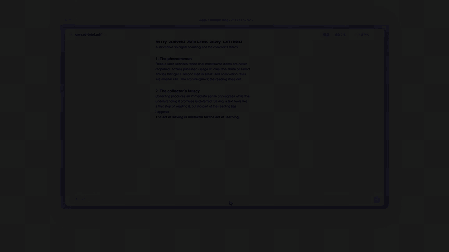

<div align="center">


# ThoughtDAG

**An open-source AI canvas that makes model context visible, editable and testable.**

Each exchange becomes a node. **Wires are the context.**<br/>
Branch a side question, connect the paths you need, and choose what the model sees next.

[Download](https://chenxiachan.github.io/thoughtdag/#download) · [Website](https://chenxiachan.github.io/thoughtdag/) · [Research](https://chenxiachan.github.io/thoughtdag/research/) · [Docs](https://chenxiachan.github.io/thoughtdag/docs/) · [中文](./README_ZH.md)


<a href="https://trendshift.io/repositories/89640?utm_source=trendshift-badge&utm_medium=badge&utm_campaign=badge-trendshift-89640" target="_blank" rel="noopener noreferrer"></a>

</div>



<p align="center"><a href="https://www.youtube.com/watch?v=-8BqAyaoNXQ">▶ Watch the 33-second tour</a></p>

## What it does

- **Edit the context.** Wires decide which conversation paths reach the next question. Disconnect a path and its nodes stay on the canvas. Preview the request before you send it.
- **Branch from what you read.** Ask from a passage in an answer, a PDF, an image or a web page, or clip it into its own node with its source.
- **Continue earlier work.** Open local Claude Code, Codex, DeepSeek Harness and Pi sessions as graphs. Recall brings relevant past discussions into a question, with an optional Jev decision layer to rank excerpts.

## Get started

| Use it as | Start with |
|---|---|
| Desktop app (macOS, Windows, Linux) | `brew install --cask thoughtdag`, or [download](https://chenxiachan.github.io/thoughtdag/#download) |
| A plugin inside DeepSeek Harness | `dsh plugin --profile web add dsh-thoughtdag` · [plugin guide](https://chenxiachan.github.io/thoughtdag/docs/guides/deepseek-harness) |
| CLI and read-only MCP for your agent | `npx thoughtdag why src/lib/api.ts` · [CLI guide](cli/README.md) |
| From source | `npm install`, then `npm run server` and `npm run dev` · [setup](docs/setup.md) |

The [browser demo](https://app.thoughtdag.workers.dev) opens an example canvas without an API key. Local sessions and recall need the desktop app or a local run.

## Research

A model's next answer depends on the context it reads in that turn, including tool output, thinking and what earlier turns left behind. These reports measure that context, and ThoughtDAG makes it editable. Methods, data and scripts are public. [All research →](https://chenxiachan.github.io/thoughtdag/research/)

| Study | Result |
|---|---|
| **Where an Agent Turn's Tokens Go** · Oct 2026<br/>[Report](https://chenxiachan.github.io/thoughtdag/research/agent-turn-tokens/) · [中文](https://chenxiachan.github.io/thoughtdag/research/agent-turn-tokens/zh/) | The answer a person reads was **1 to 7%** of an agent turn's tokens across 3,237 turns, and Claude Code and DeepSeek Harness kept the thinking in context. From the author's own logs. |
| **Context Repair for LLMs** · pilot v2, Aug 2026<br/>[Report](https://chenxiachan.github.io/thoughtdag/research/context-repair-pilot-v2/) · [中文](https://chenxiachan.github.io/thoughtdag/research/context-repair-pilot-v2/zh/) · [case study](https://chenxiachan.github.io/thoughtdag/stories/context-repair/) | Across 162 derailed outcomes (18 cases × 9 model endpoints), deleting only an error's source repaired **152**; removing the contaminated subgraph repaired all **162**. |
| **TraceVista** · collaboration<br/>[Demo](https://tracevista.pages.dev/) · [GitHub](https://github.com/Superone77/TraceVista) | Visualizes agent workflows as maps you can unfold from the overview to each action, with answers linked to the original records. Its reading layer builds on ThoughtDAG's zoom summaries. |

## The one rule

> **Wires are the context.** Connect conversation paths to use them in the next question. Disconnect a path without deleting the work.

ThoughtDAG walks a node's incoming wires, orders the relevant ancestors and builds the messages sent to the model. Explicit references and enabled recall can add material alongside them. [Context guide →](https://chenxiachan.github.io/thoughtdag/docs/guides/context-control)

| Compared with | ThoughtDAG's focus |
|---|---|
| Linear chat | Keep several lines of inquiry and choose which ones continue into the next question. |
| Mind maps and whiteboards | Connections change the model's input, not only the layout. |
| Agent workflow canvases | Edit conversational context as you explore, rather than design a pipeline of automated tasks. |
| Retrieval and automatic memory | Inspect the source-linked material a request uses, and edit or exclude it. |

[All capabilities and the roadmap →](docs/features.md)

## Models, cost and privacy

Canvases, documents and the history index stay on your machine. Remote model calls send the relevant content to the providers you configure, and those providers may charge. Local Ollama and OpenAI-compatible endpoints work too. [Setup and privacy →](docs/setup.md)

## Contributors

<a href="https://github.com/KehanLiu" title="@KehanLiu"></a>
<a href="https://github.com/nasodaengineer" title="@nasodaengineer"></a>
<a href="https://github.com/hexu321" title="@hexu321"></a>
<a href="https://github.com/Moya-Doc" title="@Moya-Doc"></a>
<a href="https://github.com/nanami-0713" title="@nanami-0713"></a>
<a href="https://github.com/LHN-xiao-hai-tun" title="@LHN-xiao-hai-tun"></a>
<a href="https://github.com/HarveyZed" title="@HarveyZed"></a>
<a href="https://github.com/Pireirik" title="@Pireirik"></a>
<a href="https://github.com/suhyungJang" title="@suhyungJang"></a>
<a href="https://github.com/Heizaillica469" title="@Heizaillica469"></a>
<a href="https://github.com/orphiczhou" title="@orphiczhou"></a>
<a href="https://github.com/Archiloss" title="@Archiloss"></a>

Contributions are welcome. Start with [CONTRIBUTING.md](./CONTRIBUTING.md).

## Supporters

With gratitude to **@andreilaiter**, ThoughtDAG's first supporter, and to everyone helping this independent open-source project grow.

<a href="https://buymeacoffee.com/chatchan92"></a>

## Cite

```bibtex
@software{chen_thoughtdag_2026,
  author  = {Chen, Xia},
  title   = {ThoughtDAG: an instrument for legible human-AI collaboration},
  year    = {2026},
  url     = {https://github.com/chenxiachan/thoughtdag},
  license = {MIT}
}
```

---

<div align="center">

[MIT](./LICENSE) © 2026 Xia Chen · [Roadmap](docs/features.md#roadmap) · [Feedback](https://github.com/chenxiachan/thoughtdag/issues)

</div>
