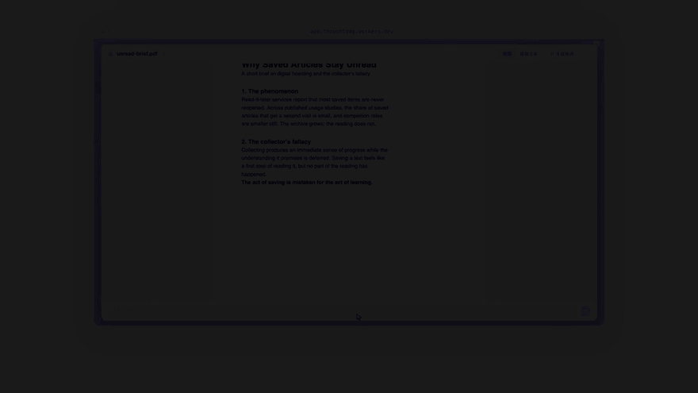

<div align="center">


# ThoughtDAG

**开源的 AI 对话画布，让模型的上下文看得见、改得动、测得出。**

问答是节点，**连线即上下文。**<br/>
沿着支线追问，把需要的思路接在一起，决定模型下一次看到什么。

[下载](https://chenxiachan.github.io/thoughtdag/zh.html#download) · [官网](https://chenxiachan.github.io/thoughtdag/zh.html) · [研究](https://chenxiachan.github.io/thoughtdag/research/zh/) · [文档](https://chenxiachan.github.io/thoughtdag/docs/zh/) · [English](./README.md)


<a href="https://trendshift.io/repositories/89640?utm_source=trendshift-badge&utm_medium=badge&utm_campaign=badge-trendshift-89640" target="_blank" rel="noopener noreferrer"></a>

</div>



<p align="center"><a href="https://www.youtube.com/watch?v=-8BqAyaoNXQ">▶ 观看 33 秒介绍</a></p>

## 它能做什么

- **编辑上下文。** 连线决定哪些对话路径进入下一问。断开一条路径，它的节点仍留在画布上。发送前可以预览这次请求。
- **从读到的内容展开。** 选中回答、PDF、图片或网页里的一段话就能追问，也能把它连同出处摘成独立节点。
- **接着以前的工作。** 把本机的 Claude Code、Codex、DeepSeek Harness 和 Pi 会话打开成图。回忆功能把相关的历史讨论带进新问题，可选的 Jev 判断层负责给片段排序。

## 开始使用

| 使用方式 | 从这里开始 |
|---|---|
| 桌面版（macOS、Windows、Linux） | `brew install --cask thoughtdag`，或[下载安装包](https://chenxiachan.github.io/thoughtdag/zh.html#download) |
| DeepSeek Harness 插件 | `dsh plugin --profile web add dsh-thoughtdag` · [插件说明](https://chenxiachan.github.io/thoughtdag/docs/zh/guides/deepseek-harness) |
| 给 Agent 用的 CLI 与只读 MCP | `npx thoughtdag why src/lib/api.ts` · [CLI 说明](cli/README.md) |
| 从源码运行 | `npm install`，再运行 `npm run server` 和 `npm run dev` · [配置说明](docs/setup_ZH.md) |

[在线体验](https://app.thoughtdag.workers.dev)可以打开示例画布，不需要 API key。本机会话和回忆功能需要桌面版或本地运行。

## 研究

模型下一步的回答取决于它这一轮读到的上下文，其中包括工具输出、思考和前几轮留下的内容。下面的报告测量这份上下文，ThoughtDAG 让它可以编辑。方法、数据和脚本全部公开。[全部研究 →](https://chenxiachan.github.io/thoughtdag/research/zh/)

| 研究 | 结果 |
|---|---|
| **Agent 一轮的 token 去了哪里** · 2026 年 10 月<br/>[报告](https://chenxiachan.github.io/thoughtdag/research/agent-turn-tokens/zh/) · [English](https://chenxiachan.github.io/thoughtdag/research/agent-turn-tokens/) | 3,237 轮里，最后给人读的回答只占一轮 token 的 **1% 到 7%**，Claude Code 和 DeepSeek Harness 还把思考留在了上下文里。数据来自作者本人的日志。 |
| **大模型的上下文修复** · 试点 v2，2026 年 8 月<br/>[报告](https://chenxiachan.github.io/thoughtdag/research/context-repair-pilot-v2/zh/) · [English](https://chenxiachan.github.io/thoughtdag/research/context-repair-pilot-v2/) · [案例](https://chenxiachan.github.io/thoughtdag/stories/context-repair/?lang=zh) | 18 个案例 × 9 个模型端点，共 162 个被带偏的结果：只删错误源头修好 **152 个**，删掉整个受污染子图后 **162 个**全部修好。 |
| **TraceVista** · 合作<br/>[在线演示](https://tracevista.pages.dev/) · [GitHub](https://github.com/Superone77/TraceVista) | 把 Agent 的工作流程画成可视化的地图，从全貌逐层展开到每一步动作，回答都链回原始记录。阅读层沿用了 ThoughtDAG 的缩放摘要。 |

## 唯一法则

> **连线即上下文。** 把需要的对话路径接入下一问；断开连线，不必删除之前的探索。

ThoughtDAG 沿着节点的入边找到相关的上游内容，排好顺序，组成发给模型的消息。显式引用和开启的回忆还会补充材料。[上下文操作说明 →](https://chenxiachan.github.io/thoughtdag/docs/zh/guides/context-control)

| 对比对象 | ThoughtDAG 侧重什么 |
|---|---|
| 线性聊天 | 同时保留几条探索路径，选择哪些进入下一问。 |
| 思维导图、白板 | 连线不仅整理思路，也改变模型收到的内容。 |
| Agent 工作流画布 | 随着讨论修改上下文，而不是编排自动执行的任务流程。 |
| 检索与自动记忆 | 核对一次请求用到的带出处材料，编辑或排除它们。 |

[全部能力与路线图 →](docs/features_ZH.md)

## 模型、成本与隐私

画布、文档和历史索引保存在本机。调用远程模型时，相关内容会发送到你配置的服务，服务商可能收费。也可以接入本地 Ollama 或兼容 OpenAI 协议的端点。[配置与隐私说明 →](docs/setup_ZH.md)

## 贡献者

<a href="https://github.com/KehanLiu" title="@KehanLiu"></a>
<a href="https://github.com/nasodaengineer" title="@nasodaengineer"></a>
<a href="https://github.com/hexu321" title="@hexu321"></a>
<a href="https://github.com/Moya-Doc" title="@Moya-Doc"></a>
<a href="https://github.com/nanami-0713" title="@nanami-0713"></a>
<a href="https://github.com/LHN-xiao-hai-tun" title="@LHN-xiao-hai-tun"></a>
<a href="https://github.com/HarveyZed" title="@HarveyZed"></a>
<a href="https://github.com/Pireirik" title="@Pireirik"></a>
<a href="https://github.com/suhyungJang" title="@suhyungJang"></a>
<a href="https://github.com/Heizaillica469" title="@Heizaillica469"></a>
<a href="https://github.com/orphiczhou" title="@orphiczhou"></a>
<a href="https://github.com/Archiloss" title="@Archiloss"></a>

欢迎参与贡献，从 [CONTRIBUTING_ZH.md](./CONTRIBUTING_ZH.md) 开始。

## 支持者

感谢首位支持者 **@andreilaiter**，也感谢每一位帮助这个独立开源项目继续成长的人。

<a href="https://buymeacoffee.com/chatchan92"></a>

## 引用

```bibtex
@software{chen_thoughtdag_2026,
  author  = {Chen, Xia},
  title   = {ThoughtDAG: an instrument for legible human-AI collaboration},
  year    = {2026},
  url     = {https://github.com/chenxiachan/thoughtdag},
  license = {MIT}
}
```

---

<div align="center">

[MIT](./LICENSE) © 2026 Xia Chen · [Roadmap](docs/features_ZH.md#roadmap) · [反馈](https://github.com/chenxiachan/thoughtdag/issues)

</div>
